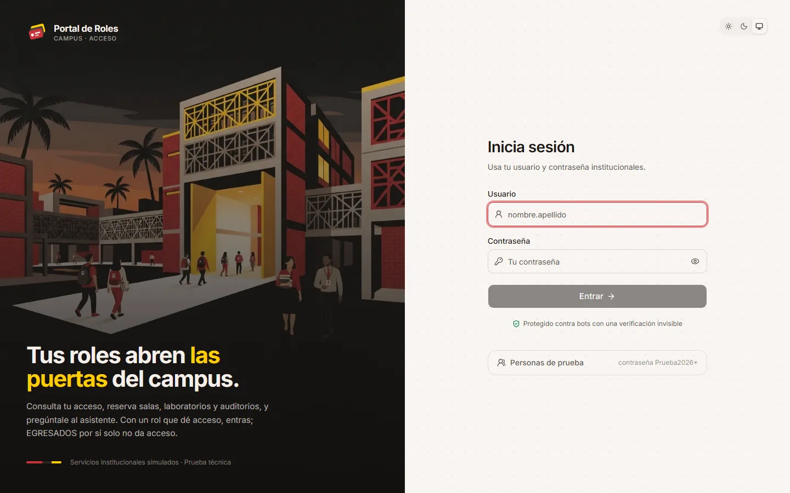
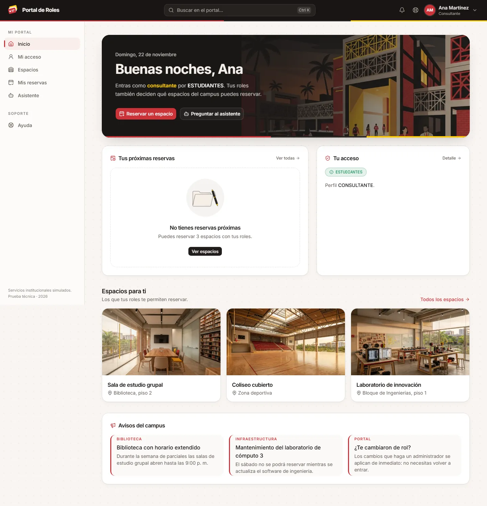
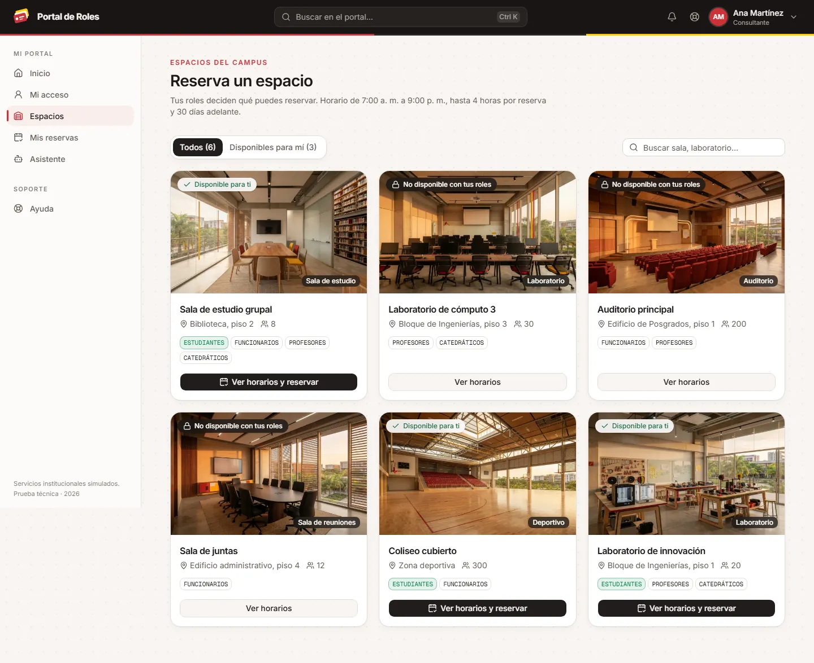
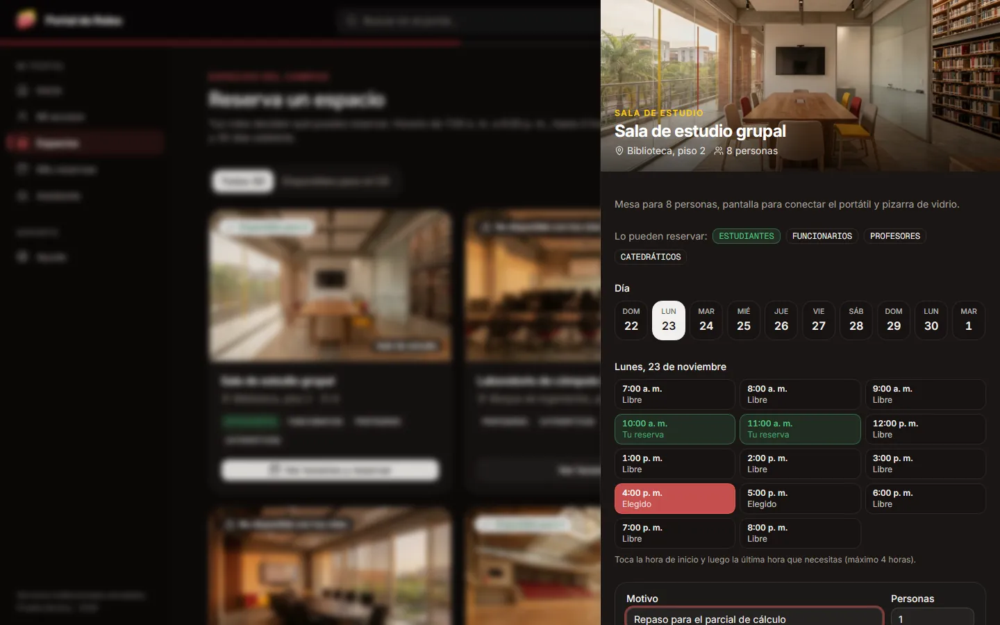
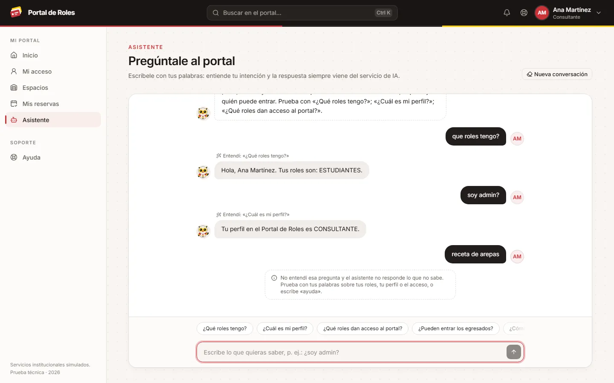
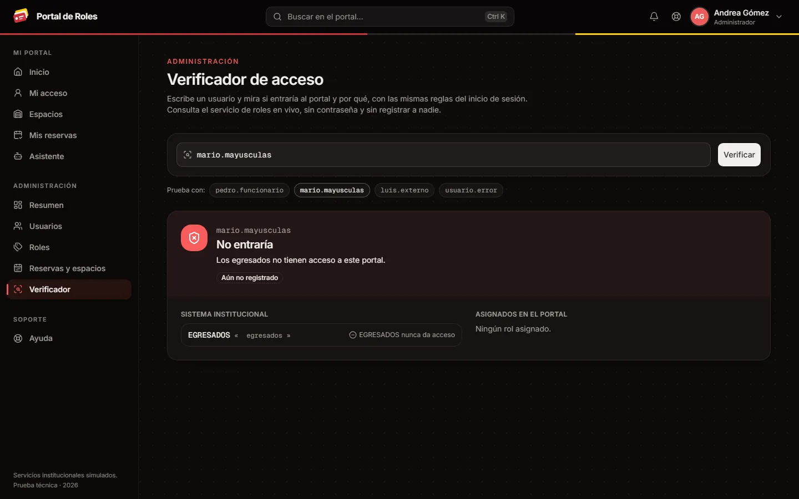

# Portal de Roles

Aplicación web que decide **quién entra y con qué perfil** según los roles institucionales de cada persona
(los del sistema institucional más los que asigna un administrador), y que usa esos mismos roles para algo
útil en el campus: **reservar espacios** (salas de estudio, laboratorios, auditorio, coliseo…).
Prueba técnica de Ingeniería de Sistemas.

- **Backend:** Python 3.12 · FastAPI · SQLAlchemy 2 (asíncrono) · PostgreSQL 17 · httpx
- **Frontend:** React 19 · TypeScript · Vite · Tailwind CSS · TanStack Query 5 · React Router · Jotai
- **Contenedores:** Podman (4 contenedores en una red; solo se publica `localhost:8080`)

| Inicio de sesión | Inicio |
|---|---|
|  |  |
| **Espacios del campus** | **Reservar (modo oscuro)** |
|  |  |
| **Asistente** | **Verificador de acceso (admin)** |
|  |  |

---

## Contenido

1. [Levantar todo con un comando](#1-levantar-todo-con-un-comando)
2. [Cómo probarlo: personas de prueba](#2-cómo-probarlo-personas-de-prueba)
3. [Qué hace el portal](#3-qué-hace-el-portal)
4. [Arquitectura](#4-arquitectura)
5. [Reglas de acceso: dónde y cómo se cumplen](#5-reglas-de-acceso-dónde-y-cómo-se-cumplen)
6. [Asistente](#6-asistente)
7. [Seguridad](#7-seguridad)
8. [Decisiones y por qué](#8-decisiones-y-por-qué)
9. [Extras opcionales](#9-extras-opcionales)
10. [Pruebas automáticas y desarrollo local](#10-pruebas-automáticas-y-desarrollo-local)
11. [Pendientes y mejoras](#11-pendientes-y-mejoras)
12. [Uso de asistentes de IA](#12-uso-de-asistentes-de-ia)

---

## 1. Levantar todo con un comando

### Requisitos

- **Podman 4.4 o superior** (probado con 5.8).
  - Linux: el paquete `podman` de la distribución.
  - Windows y macOS: [Podman Desktop](https://podman-desktop.io) o `podman machine init && podman machine start`.
- **bash**: en Linux y macOS ya viene; en Windows, Git Bash (incluido con Git for Windows) o WSL.
- Internet la primera vez (descarga las imágenes `postgres:17`, `node:22-alpine`, `python:3.12-slim` y
  `nginx-unprivileged`).

No hace falta instalar Python, Node ni PostgreSQL: todo se compila dentro de los contenedores.

### Arranque

```bash
git clone <url-del-repositorio> portal-roles
cd portal-roles
./levantar.sh
```

Al terminar muestra `Portal de Roles listo → http://localhost:8080`. La primera vez tarda unos minutos
(descarga y compila las imágenes); después, segundos.

`levantar.sh` hace todo esto:

1. Si no existe `.env`, lo crea a partir de `.env.example` con un `SESSION_SECRET` y una clave de
   PostgreSQL aleatorios.
2. Crea la red `portal-red` y el volumen `portal-db-datos` (los datos sobreviven a recrear los contenedores).
3. Construye las imágenes del backend y del frontend.
4. Arranca `db`, `datamock`, `backend` y `frontend`, en ese orden, esperando a que cada uno responda.

Otras opciones:

```bash
./levantar.sh --estado    # ver los contenedores y sus puertos
./levantar.sh --bajar     # detener y borrar los contenedores (los datos se conservan)
./levantar.sh --limpiar   # además borra el volumen: la próxima vez arranca con la base vacía
PUERTO=9090 ./levantar.sh # publicar en otro puerto si el 8080 está ocupado
```

Para probar la renovación del token del servicio de roles, pon `TOKEN_VIGENCIA_SEGUNDOS=20` en `.env` y
vuelve a ejecutar `./levantar.sh`.

La documentación interactiva de la API queda en <http://localhost:8080/api/docs>.

> **Si actualizas el código con la aplicación abierta:** la página avisa *"Hay una versión nueva del portal"*
> con un botón para recargar.

---

## 2. Cómo probarlo: personas de prueba

Todas usan la contraseña **`Prueba2026*`**. En la pantalla de inicio hay un desplegable **"Personas de
prueba"** que llena el formulario con un clic.

| Usuario | Roles en el sistema institucional | Resultado esperado |
|---|---|---|
| `admin.prueba` | FUNCIONARIOS | Entra como **ADMINISTRADOR** (está en `ADMIN_USERNAMES`) |
| `ana.estudiante` | ESTUDIANTES | Entra como CONSULTANTE |
| `carlos.profesor` | PROFESORES, CATEDRÁTICOS | Entra (dos roles, sin repetir) |
| `diana.catedratica` | `Catedraticos` (sin tilde) | Entra: se compara sin tildes ni mayúsculas |
| `pedro.funcionario` | EGRESADOS, FUNCIONARIOS | Entra **por FUNCIONARIOS** |
| `laura.egresada` | EGRESADOS | ✗ *Los egresados no tienen acceso a este portal.* |
| `mario.mayusculas` | `"  egresados "` | ✗ *Los egresados no tienen acceso a este portal.* |
| `sofia.sinrol` | (ninguno) | ✗ *No tienes un rol con acceso a este portal.* |
| `jorge.contratista` | CONTRATISTAS (no está en el catálogo) | ✗ *No tienes un rol con acceso a este portal.* |
| `luis.externo` | No existe en el sistema de roles (HTTP 200, `codigo "404"`) | ✗ *No tienes un rol con acceso…* — **entra** si un admin le asigna un rol |
| `usuario.error` | El servicio de roles responde HTTP 500 | ✗ *No pudimos verificar tus roles. Intenta más tarde.* |

Con cualquier usuario y una contraseña equivocada: *Usuario o contraseña incorrectos.*

### Recorrido sugerido

1. Entra con `laura.egresada`, `sofia.sinrol` y `usuario.error` y mira cada motivo de rechazo.
2. Entra con `ana.estudiante`: queda registrada como CONSULTANTE. Escribe `/admin/usuarios` en la barra de
   direcciones: el portal te devuelve a **Mi acceso** (y el backend responde 403 si se llama la API).
3. Con Ana ve a **Espacios**: puede reservar la sala de estudio, el coliseo y el laboratorio de innovación
   (por ESTUDIANTES), pero no el auditorio. Reserva un horario.
4. En otra ventana privada entra con `admin.prueba` → **Usuarios**: aparece Ana como *Registrado al entrar*.
   En **Reservas y espacios** cancela la reserva de Ana escribiendo un motivo: Ana lo verá en la campanita.
   Desactívala y, en la ventana de Ana, haz cualquier acción: la sesión se cierra con
   *Tu usuario está desactivado. Habla con un administrador.*
5. En **Verificador** escribe `mario.mayusculas` o `luis.externo` y mira por qué entrarían o no.
6. Crea a `luis.externo` (búscalo en el directorio) con el rol FUNCIONARIOS: ahora sí entra.
7. En **Roles** intenta eliminar FUNCIONARIOS: el backend responde 409 y la pantalla explica que está
   asignado. EGRESADOS no tiene botón de eliminar.
8. En **Asistente** pulsa "¿Qué roles tengo?" o escribe con tus palabras "soy admin?". Escribe algo que no
   sepa (`receta de arepas`): no inventa una respuesta.
9. Recarga la página en `/admin/usuarios`: sigue funcionando (fallback de SPA en nginx).

---

## 3. Qué hace el portal

| Pantalla | Quién | Qué hace |
|---|---|---|
| **Inicio de sesión** | Todos | Usuario y contraseña, con el motivo exacto cuando alguien no entra. Muestra el progreso: verificación, credenciales, roles, decisión. |
| **Inicio** | Ambos perfiles | Saludo, próximas reservas, resumen del acceso, espacios disponibles y avisos del campus. |
| **Mi acceso** | Ambos perfiles | Nombre, correo, perfil y roles: los del sistema institucional y los asignados, por separado, marcando cuáles dan acceso y por qué. |
| **Espacios** | Ambos perfiles | Espacios del campus con foto, capacidad y roles que los habilitan. Selector de día y horas libres u ocupadas. |
| **Mis reservas** | Ambos perfiles | Próximas e historial; cancelar. Si un admin la cancela, aparece el motivo. |
| **Asistente** | Ambos perfiles | Ver [sección 6](#6-asistente). |
| **Ayuda** | Ambos perfiles | Preguntas frecuentes y contacto de mesa de ayuda (ficticio). |
| **Resumen** | Administrador | Indicadores y actividad reciente (auditoría). |
| **Usuarios** | Administrador | Crear (con búsqueda en el directorio), editar, activar/desactivar y eliminar; perfiles y roles asignados. |
| **Roles** | Administrador | Catálogo: crear, editar, activar y eliminar (con las reglas de EGRESADOS y 409). |
| **Reservas y espacios** | Administrador | Todas las reservas próximas (cancelar con motivo) y qué roles habilitan cada espacio. |
| **Verificador** | Administrador | Escribe un usuario y muestra si entraría y por qué, con el servicio de roles en vivo, sin contraseña ni registro. |

Además: buscador rápido **Ctrl + K** (páginas, espacios, usuarios y acciones), **notificaciones**, tema claro
y oscuro, y diseño adaptable a celular.

**Reserva de espacios.** Es la parte "útil" del portal: los mismos roles que deciden el acceso deciden qué
se puede reservar (EGRESADOS nunca habilita nada). Reglas, todas en el backend: de 7:00 a. m. a 9:00 p. m.,
de 1 a 4 horas, hasta 30 días adelante, nunca en el pasado (hora de Colombia), sin cruces en el mismo
espacio ni de la misma persona en dos lugares, sin superar la capacidad y máximo 3 reservas pendientes por
persona. El perfil de administrador **gestiona** los espacios pero no habilita reservas por sí solo: también
reserva según sus roles.

---

## 4. Arquitectura

```
Navegador ──► http://localhost:8080
   │
[frontend]  nginx-unprivileged: sirve la app compilada y reenvía /api/ → backend:8000   ← único puerto publicado
   │ /api/
[backend]   FastAPI (uvicorn) ──► [datamock]  node:22-alpine + dataMock.js (4000)
   │
[db]        postgres:17 (5432) — volumen portal-db-datos

Red de Podman: portal-red (los contenedores se encuentran por nombre: db, datamock, backend)
```

```
.
├── levantar.sh               # un solo comando (podman)
├── .env.example              # todas las variables; el .env real no se sube
├── dataMock.js               # sin cambios
├── REDES.md                  # respuestas de redes
├── deploy/quadlet/           # extra: unidades Quadlet (systemd) para servidores Linux
├── backend/
│   ├── Containerfile         # dos etapas con uv, usuario sin privilegios
│   ├── app/
│   │   ├── acceso.py         # ★ reglas de acceso (funciones puras)
│   │   ├── datamock.py       # cliente httpx: token, 'codigo', timeout
│   │   ├── deps.py           # sesión y permisos (401/403), revalidación en cada petición
│   │   ├── espacios.py       # reglas de las reservas
│   │   ├── interprete.py     # intérprete del asistente
│   │   ├── proteccion.py     # protección contra bots en el login
│   │   ├── routers/          # auth, admin_roles, admin_usuarios, asistente, espacios
│   │   ├── models.py         # tablas
│   │   └── main.py
│   └── tests/                # pytest contra el dataMock.js real
└── frontend/
    ├── Containerfile         # build con Node 22 → nginx (dos etapas)
    ├── nginx.conf            # fallback de SPA, proxy /api/, límite de frecuencia en el login
    ├── public/img/           # logo, ilustraciones y fotos de los espacios
    └── src/
        ├── paginas/          # login, inicio, mi-acceso, espacios, reservas, asistente, ayuda, admin…
        ├── consultas/        # TanStack Query (todas las llamadas a la API)
        ├── estado/           # Jotai: sesión y tema
        └── components/
```

### Base de datos

PostgreSQL 17 en el contenedor `db` (host `db` dentro de la red; el 5432 no se publica). El backend se
conecta con SQLAlchemy 2 asíncrono (`asyncpg`). Las tablas se crean al arrancar:

| Tabla | Qué guarda |
|---|---|
| `roles` | Catálogo: código (único normalizado), nombre, descripción, activo |
| `usuarios` | Usuario (único), nombre, correo, perfil, activo, origen, último ingreso |
| `usuario_roles` | Roles que un administrador asignó a cada usuario (borrar un rol asignado → `RESTRICT`) |
| `espacios`, `espacio_roles` | Espacios del campus y qué roles pueden reservarlos |
| `reservas` | Quién, qué espacio, fecha, horas, motivo, estado, quién canceló y por qué |
| `auditoria` | Quién cambió qué y cuándo |

Los roles institucionales no se guardan: se consultan en vivo a dataMock al iniciar sesión. Las
contraseñas tampoco: las valida dataMock.

### Rutas de la API

| Método y ruta | Quién | Para qué |
|---|---|---|
| `GET /api/auth/reto` | Todos | Reto de la verificación anti-bots |
| `POST /api/auth/login` | Todos | Iniciar sesión (aplica todas las reglas) |
| `POST /api/auth/logout` | Con sesión | Cerrar sesión |
| `GET /api/auth/me` | Con sesión | Datos de Mi acceso |
| `GET /api/espacios`, `GET /api/espacios/reglas` | Con sesión | Espacios (con si puedes reservarlos) y reglas |
| `GET /api/espacios/{id}/disponibilidad?fecha=` | Con sesión | Franjas ocupadas de un día |
| `POST /api/reservas` | Con sesión | Reservar |
| `GET /api/reservas/mias` | Con sesión | Mis reservas |
| `POST /api/reservas/{id}/cancelar` | Dueño o ADMIN | Cancelar (un admin debe dar el motivo) |
| `GET /api/avisos`, `POST /api/avisos/leidos` | Con sesión | Avisos de reservas canceladas por un admin |
| `GET /api/asistente/preguntas` | Con sesión | Preguntas para los botones, según el perfil |
| `POST /api/asistente` | Con sesión | Enviar una pregunta al asistente |
| `GET, POST /api/admin/roles` · `PUT, DELETE /api/admin/roles/{id}` | ADMINISTRADOR | Catálogo de roles |
| `GET, POST /api/admin/usuarios` · `PUT, DELETE /api/admin/usuarios/{id}` | ADMINISTRADOR | Usuarios |
| `GET /api/admin/personas?buscar=` | ADMINISTRADOR | Buscar en el directorio institucional |
| `GET /api/admin/verificar/{usuario}` | ADMINISTRADOR | Verificador de acceso |
| `GET /api/admin/reservas` · `PUT /api/admin/espacios/{id}` | ADMINISTRADOR | Reservas y espacios |
| `GET /api/admin/resumen`, `GET /api/admin/auditoria` | ADMINISTRADOR | Indicadores y actividad |
| `GET /api/health` | Todos | Estado del backend y de la base de datos |

Toda ruta `/api/admin/*` responde **401** sin sesión y **403** a un CONSULTANTE (lo verifican las pruebas
para cada ruta).

---

## 5. Reglas de acceso: dónde y cómo se cumplen

Todas se aplican en el backend. El frontend solo refleja lo que el backend decide.

| Regla | Implementación |
|---|---|
| Usuario y contraseña con `POST /sso/login` | `datamock.py → login()`; `codigo "401"` → *Usuario o contraseña incorrectos.* |
| Roles = institucionales + asignados, sin repetir | `acceso.py → evaluar()`, deduplica por la forma normalizada |
| Comparar sin mayúsculas, tildes ni espacios | `acceso.py → normalizar()` (NFD, quita marcas diacríticas, `strip`, `lower`) |
| Da acceso: en el catálogo, activo y no EGRESADOS | `acceso.py → evaluar_rol()`; `EGRESADOS` es una constante en el código |
| Perfil: `ADMIN_USERNAMES` o asignado por un admin | `servicios.py → perfil_efectivo()` |
| Registro automático como CONSULTANTE | `routers/auth.py → login()`, solo si entra (quien es rechazado no queda registrado) |
| Usuario desactivado no entra | Se revisa antes de consultar los roles; y en cada petición (`deps.py`) |
| Servicio de roles con error o sin respuesta en 5 s | `httpx.Timeout(5)`; cualquier error, `codigo` distinto de 200/404 o formato inesperado → 503 |
| Revisar `codigo`, no solo el HTTP | `GET /roles/{usuario}` con HTTP 200 y `codigo "404"` = sin roles institucionales |
| `/api/admin/*`: 401 sin sesión, 403 consultante | Dependencia `solo_admin` declarada en cada router de administración |
| Si no entra, no hay sesión | El login limpia la sesión al empezar y solo la escribe al final, si entra |
| Código de rol único (normalizado) y no editable | Columna `codigo_normalizado UNIQUE`; `RolEditar` no tiene campo `codigo` (enviarlo da 422) |
| Catálogo inicial desde `GET /roles` | Al arrancar, si la tabla está vacía (con reintentos mientras dataMock arranca) y otra vez en el primer login |
| EGRESADOS no se elimina; rol asignado → 409 | `routers/admin_roles.py`, más `ON DELETE RESTRICT` en la tabla `usuario_roles` |
| Admin no se elimina ni se desactiva a sí mismo | `routers/admin_usuarios.py` → 409 |

---

## 6. Asistente

Cumple lo que pide el enunciado:

- **Un botón por cada pregunta disponible para el perfil** (5 para un consultante, 8 para un administrador),
  leídas de `GET /ia/preguntas`, más una caja para escribir.
- El frontend envía la pregunta al backend; **el backend la envía a `POST /ia/chat`** y devuelve la respuesta.
- **El backend reemplaza las variables** (`{nombre}`, `{roles}`, `{perfil}`, `{roles_con_acceso}`,
  `{total_usuarios}`, `{total_administradores}`) con datos reales, calculando solo las que la respuesta usa.
- **Si la IA no responde, no se muestra ninguna respuesta**: la interfaz muestra un aviso del sistema, nunca
  una respuesta inventada.
- **Las preguntas de ADMINISTRADOR solo se responden a administradores**, filtradas en el backend.
- Mientras la IA responde, se muestra que **está escribiendo**.

**Mejora: intérprete de intención.** La IA simulada solo entiende coincidencias exactas. Para que se pueda
escribir con naturalidad, el backend tiene un intérprete local muy pequeño basado en reglas
(`app/interprete.py`) que reconoce la intención de mensajes como *"que roles tengo"*, *"soy admin?"* o
*"cuántos admins hay"* y los traduce a la **pregunta oficial** más parecida. La respuesta **siempre** viene de
`POST /ia/chat` (la interfaz muestra *Entendí: «¿Cuál es mi perfil?»*); el intérprete no genera respuestas.
Si no reconoce la intención, no hay respuesta. Los saludos, "gracias" y "ayuda" los contesta el portal con
mensajes fijos, marcados como *Mensaje del portal*. Las preguntas de administrador siguen bloqueadas para
los consultantes aunque se escriban con otras palabras.

La API conserva el comportamiento literal del enunciado: `POST /api/asistente` con `"estricto": true` (el
valor por defecto) envía la pregunta tal cual, sin intérprete. La interfaz usa el intérprete.

---

## 7. Seguridad

- **Sesión en cookie firmada** (`SessionMiddleware`, `httpOnly`, `SameSite=Lax`, 8 horas). Nada en
  `localStorage`. Guarda solo el id del usuario y sus roles institucionales del momento del login. Está
  firmada (no se puede alterar) pero no cifrada; por eso no lleva nada secreto. Detrás de HTTPS,
  `SESION_SOLO_HTTPS=true` le agrega el atributo `Secure`.
- **Revalidación en cada petición**: el backend vuelve a leer de la base de datos si la persona sigue
  activa, su perfil y sus roles asignados.
- **Protección contra bots en el inicio de sesión** (autoalojada, sin servicios externos; se activa con
  `PROTECCION_BOTS=true`):
  - **Verificación invisible por prueba de trabajo**: el navegador pide un reto firmado y calcula, en un Web
    Worker, un número que hace que `SHA-256(reto + número)` empiece con 16 bits en cero (unos 100–200 ms).
    El reto vence en 2 minutos y solo sirve una vez. Tras 3 intentos fallidos desde una IP, la dificultad
    sube a 19 bits (8 veces más trabajo).
  - **Límite de intentos**: 5 fallos contra un usuario o 10 desde una IP → 5 minutos de bloqueo (429).
  - **Límite de frecuencia en nginx** para `/api/auth/login` y `/api/auth/reto`.
  - **Campo trampa** invisible que solo rellenan los bots.
  - nginx impone la IP real del cliente (`X-Forwarded-For $remote_addr`) para que no se pueda falsificar.
- **Encabezados de seguridad** en nginx (`X-Content-Type-Options`, `X-Frame-Options`, `Referrer-Policy`).
- Contenedores con **usuarios sin privilegios** (backend, datamock y nginx).
- **Credenciales en `.env`** (no se sube); `levantar.sh` genera secretos aleatorios.

---

## 8. Decisiones y por qué

- **Códigos de respuesta del login:** 401 credenciales incorrectas, 403 sin acceso (egresados, sin rol,
  desactivado), 503 cuando el servicio de roles falla. El cuerpo siempre trae el mensaje exacto del
  enunciado en `detail`.
- **SSO caído.** El enunciado no define el mensaje si falla `POST /sso/login`. Respondo 503 con *No pudimos
  validar tu usuario en este momento. Intenta más tarde.*, en lugar de decir que la contraseña es incorrecta.
- **Orden de verificación:** credenciales → desactivado → roles. A un usuario desactivado no hace falta
  consultarle los roles: no entra de todas formas.
- **Los roles institucionales no se piden en cada petición** (sería una llamada externa por cada clic); se
  refrescan al volver a iniciar sesión. Lo que cambia un administrador sí se aplica de inmediato.
- **Perfil de los administradores de `ADMIN_USERNAMES`:** no se puede cambiar desde la interfaz (409). Un
  administrador tampoco puede quitarse su propio perfil, para no quedarse fuera por accidente.
- **El nombre de usuario no se edita.** Es la identidad que entrega el sistema institucional. Se guarda en
  minúsculas y sin espacios, igual que lo compara dataMock.
- **Códigos de rol** se guardan recortados y en mayúsculas (conservando las tildes: `CATEDRÁTICOS`), con una
  columna normalizada única que impide duplicados que solo difieren en tildes, mayúsculas o espacios.
- **Reserva de espacios:** los roles (no el perfil) deciden qué se puede reservar, para que el portal use
  su propia regla de negocio de punta a punta. Un administrador que cancela la reserva de otra persona debe
  escribir el motivo, y esa persona recibe un aviso.
- **Esquema con `create_all`** al arrancar, sin migraciones (ver pendientes).
- **`levantar.sh` con Podman puro** en lugar de `compose.yaml`: `podman compose` necesita un proveedor
  externo (docker-compose o podman-compose) que no viene instalado por defecto; el script solo necesita
  Podman y funciona igual en Linux, macOS y Windows (Git Bash).
- **dataMock.js se copia al contenedor** con `podman cp` en lugar de montarlo como volumen: evita los
  problemas de rutas y de SELinux al montar archivos desde Windows o macOS.
- **nginx sin privilegios** (escucha en 8080): coherente con Podman rootless (ver `REDES.md`).
- **Versión publicada:** cada compilación publica `/version.json`. Si alguien tiene el portal abierto
  mientras se publica una versión nueva, ve un aviso para recargar, y si falla la carga de una parte de la
  app, se recarga sola una vez.
- **Personas de prueba en la pantalla de inicio:** facilitan la evaluación. Son datos ficticios del mock; en
  un despliegue real se ocultan compilando con `VITE_PERSONAS_PRUEBA=false`.

### Librerías adicionales y por qué

| Librería | Por qué |
|---|---|
| **shadcn/ui** (sobre Radix UI) | Diálogos, menús, selectores, pestañas, acordeones e interruptores accesibles (teclado, foco, lectores de pantalla). El código queda en `src/components/ui`. |
| **cmdk** (vía shadcn) | El buscador rápido Ctrl + K. |
| **Motion** (`motion`) | Animaciones del login, del chat, de los contadores y de las listas, respetando *prefers-reduced-motion*. |
| **lucide-react** | Iconos. |
| **sonner** | Avisos de éxito, error y notificaciones. |
| **Inter** y **Geist Mono** (`@fontsource-variable`) | Tipografías servidas desde la propia app, sin CDN. Inter es la que usa el sitio web de Uninorte. |
| **pydantic-settings** | Lee el `.env` con validación (falla al arrancar si falta una variable). |
| **uv** | Dependencias de Python reproducibles (`uv.lock`) en el Containerfile. |
| **aiosqlite** (solo pruebas) | Base de datos temporal para las pruebas, sin levantar PostgreSQL. |

**Diseño.** Estilo institucional con la paleta de los colores de Uninorte (rojo Pantone 1797C, negro y
amarillo roble Pantone 116C) y su tipografía web (Inter). El rojo se usa con moderación, como acento, para
que no se confunda con los mensajes de error. El logo (tres carnés superpuestos: los roles que se suman) está
dibujado en SVG. Tema claro y oscuro.

---

## 9. Extras opcionales

| Extra del enunciado | Estado |
|---|---|
| Pruebas automáticas (pytest) de las reglas de acceso | ✅ 163 pruebas contra el `dataMock.js` real |
| Guardar el token y pedir uno nuevo solo cuando venza | ✅ Caché con margen de 5 s; si dataMock lo rechaza (`codigo "401"`) se pide otro y se reintenta una vez |
| Cambios del admin aplicados en la siguiente acción | ✅ Revalidación en cada petición y en cada cambio de página |
| Buscar personas con `GET /personas` al crear un usuario | ✅ Buscador en el diálogo de nuevo usuario |
| Que se vea bien en el celular | ✅ Menú lateral desplegable, tablas convertidas en tarjetas |
| Unidades Quadlet **o** registro de quién cambió qué y cuándo | ✅ **Los dos**: `deploy/quadlet/` y la tabla `auditoria` con "Actividad reciente" |

Además del enunciado: reserva de espacios según roles, verificador de acceso, avisos de cancelación,
intérprete del asistente, buscador Ctrl + K, centro de ayuda, protección contra bots y aviso de versión nueva.

---

## 10. Pruebas automáticas y desarrollo local

### Pruebas del backend

Requieren [uv](https://docs.astral.sh/uv/) y Node.js 18+ (las pruebas lanzan el `dataMock.js` real en un
puerto libre, con tokens de 2 segundos para probar la renovación):

```bash
cd backend
uv sync
uv run pytest -q
```

Cubren las 11 personas de prueba de punta a punta, las 401/403 de cada ruta de administración, la
unicidad normalizada de los códigos, los 409, el asistente por perfil y el intérprete, el timeout del
servicio de roles, que los cambios del administrador se apliquen en la siguiente acción, las reglas de las
reservas, el verificador y la protección contra bots.

### Desarrollo sin contenedores

```bash
node dataMock.js                       # terminal 1 → http://localhost:4000
cd backend && uv run fastapi dev       # terminal 2 → http://localhost:8000 (necesita backend/.env*)
cd frontend && npm install && npm run dev   # terminal 3 → http://localhost:5173 (reenvía /api al 8000)
```

\* Un `backend/.env` con las variables de `.env.example`, cambiando `MOCK_API_URL=http://localhost:4000`
y apuntando `DATABASE_URL` a un PostgreSQL local (o `sqlite+aiosqlite:///./portal.db` para probar rápido,
instalando `aiosqlite`).

---

## 11. Pendientes y mejoras

- **Migraciones con Alembic** en lugar de `create_all`, para poder cambiar el esquema sin perder datos.
- **Protección CSRF explícita** (token doble o encabezado propio). Hoy la mitigan `SameSite=Lax` y que la API
  solo acepte JSON, pero un token sería más robusto.
- **Contadores de la protección anti-bots en Redis** si el backend corre con varias réplicas (hoy viven en la
  memoria del único proceso).
- **Refrescar los roles institucionales** periódicamente durante la sesión.
- **Pruebas del frontend** (Vitest + Testing Library) y una prueba E2E con Playwright en CI.
- **Paginación** en usuarios, reservas y auditoría si crecen mucho.
- HTTPS y cabecera `Content-Security-Policy` en nginx para un despliegue real.

---

## 12. Uso de asistentes de IA

- **Claude Code** (Anthropic, modelo Claude Opus 5.5): análisis del enunciado y de `dataMock.js`
  (identificar los casos límite, como el `codigo` que no coincide con el estado HTTP, los roles con tildes y
  espacios, el timeout y la caché del token) y generación del código a partir de las decisiones de
  arquitectura, funcionalidad y diseño que fui tomando.
- **Gemini** (Google): generación de imágenes. Propuestas de logo (elegí el concepto de los carnés
  superpuestos, que luego se redibujó en SVG), la ilustración del campus del inicio de sesión, las fotos de
  los seis espacios, el avatar del asistente y las ilustraciones de los estados vacíos, de error y de la
  página no encontrada.
