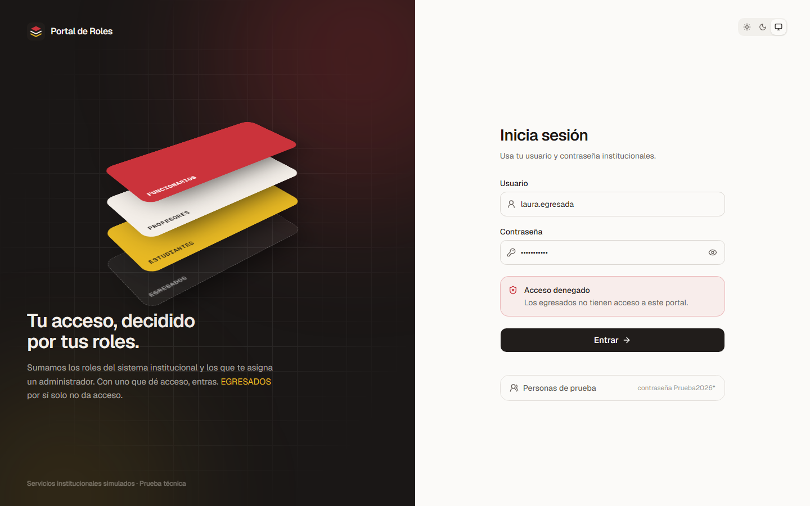
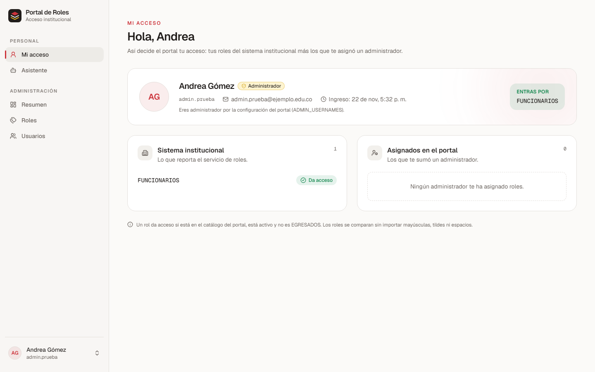
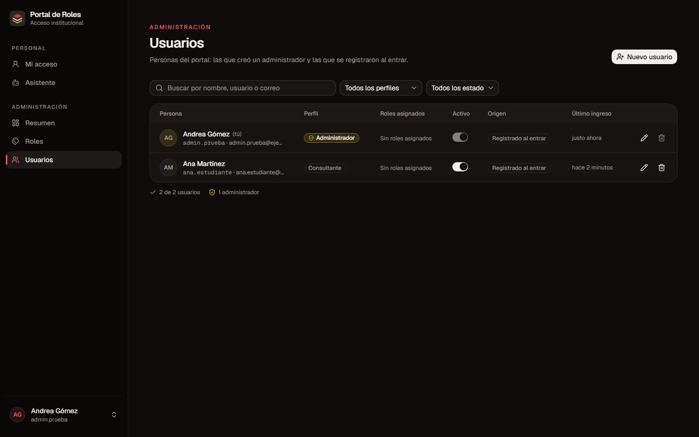
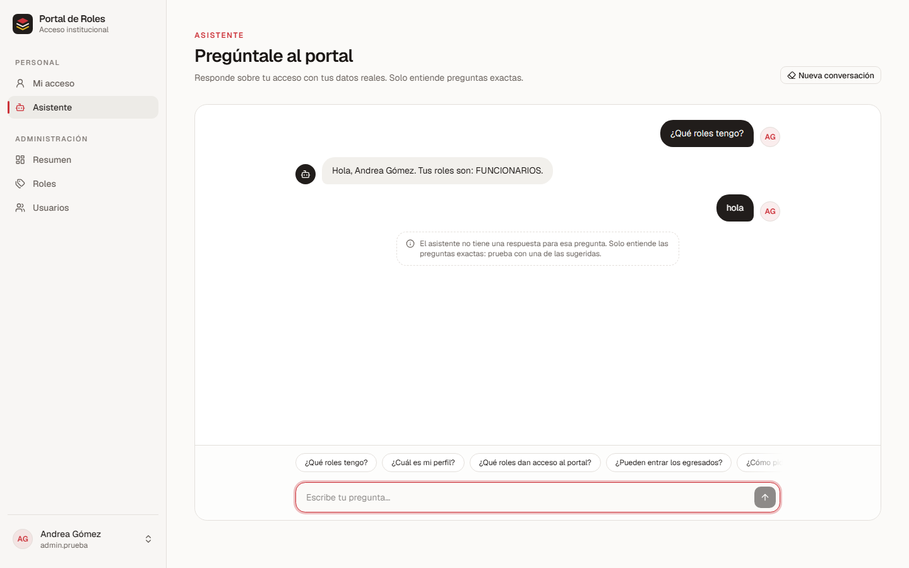

# Portal de Roles

Aplicación web que decide **quién entra y con qué perfil** según los roles institucionales de cada persona
(los del sistema institucional más los que asigna un administrador). Prueba técnica de Ingeniería de Sistemas.

- **Backend:** Python 3.12 · FastAPI · SQLAlchemy 2 (asíncrono) · PostgreSQL 17 · httpx
- **Frontend:** React 19 · TypeScript · Vite · Tailwind CSS · TanStack Query 5 · React Router · Jotai
- **Contenedores:** Podman (4 contenedores en una red; solo se publica `localhost:8080`)

| Inicio de sesión | Mi acceso |
|---|---|
|  |  |
| **Usuarios (modo oscuro)** | **Asistente** |
|  |  |

---

## Contenido

1. [Levantar todo con un comando](#1-levantar-todo-con-un-comando)
2. [Cómo probarlo: personas de prueba](#2-cómo-probarlo-personas-de-prueba)
3. [Arquitectura](#3-arquitectura)
4. [Reglas de acceso: dónde y cómo se cumplen](#4-reglas-de-acceso-dónde-y-cómo-se-cumplen)
5. [Decisiones y por qué](#5-decisiones-y-por-qué)
6. [Extras opcionales](#6-extras-opcionales)
7. [Pruebas automáticas y desarrollo local](#7-pruebas-automáticas-y-desarrollo-local)
8. [Pendientes y mejoras](#8-pendientes-y-mejoras)
9. [Uso de asistentes de IA](#9-uso-de-asistentes-de-ia)

---

## 1. Levantar todo con un comando

### Requisitos

- **Podman 4.4 o superior** (probado con 5.8).
  - Linux: el paquete `podman` de la distribución.
  - Windows y macOS: [Podman Desktop](https://podman-desktop.io) o `podman machine init && podman machine start`.
- **bash**: en Linux y macOS ya viene; en Windows, Git Bash (incluido con Git for Windows) o WSL.
- Internet la primera vez (descarga las imágenes `postgres:17`, `node:22-alpine`, `python:3.12-slim` y
  `nginx-unprivileged`).

No hace falta instalar Python, Node ni PostgreSQL: todo se compila dentro de los contenedores.

### Arranque

```bash
git clone <url-del-repositorio> portal-roles
cd portal-roles
./levantar.sh
```

Al terminar muestra `Portal de Roles listo → http://localhost:8080`. La primera vez tarda unos minutos
(descarga y compila las imágenes); después, segundos.

`levantar.sh` hace todo esto:

1. Si no existe `.env`, lo crea a partir de `.env.example` con un `SESSION_SECRET` y una clave de
   PostgreSQL aleatorios.
2. Crea la red `portal-red` y el volumen `portal-db-datos` (los datos sobreviven a recrear los contenedores).
3. Construye las imágenes del backend y del frontend.
4. Arranca `db`, `datamock`, `backend` y `frontend`, en ese orden, esperando a que cada uno responda.

Otras opciones:

```bash
./levantar.sh --estado    # ver los contenedores y sus puertos
./levantar.sh --bajar     # detener y borrar los contenedores (los datos se conservan)
./levantar.sh --limpiar   # además borra el volumen: la próxima vez arranca con la base vacía
PUERTO=9090 ./levantar.sh # publicar en otro puerto si el 8080 está ocupado
```

Para probar la renovación del token del servicio de roles, pon `TOKEN_VIGENCIA_SEGUNDOS=20` en `.env` y
vuelve a ejecutar `./levantar.sh`.

La documentación interactiva de la API queda en <http://localhost:8080/api/docs>.

---

## 2. Cómo probarlo: personas de prueba

Todas usan la contraseña **`Prueba2026*`**. En la pantalla de inicio hay un desplegable **"Personas de
prueba"** que llena el formulario con un clic.

| Usuario | Roles en el sistema institucional | Resultado esperado |
|---|---|---|
| `admin.prueba` | FUNCIONARIOS | Entra como **ADMINISTRADOR** (está en `ADMIN_USERNAMES`) |
| `ana.estudiante` | ESTUDIANTES | Entra como CONSULTANTE |
| `carlos.profesor` | PROFESORES, CATEDRÁTICOS | Entra (dos roles, sin repetir) |
| `diana.catedratica` | `Catedraticos` (sin tilde) | Entra: se compara sin tildes ni mayúsculas |
| `pedro.funcionario` | EGRESADOS, FUNCIONARIOS | Entra **por FUNCIONARIOS** |
| `laura.egresada` | EGRESADOS | ✗ *Los egresados no tienen acceso a este portal.* |
| `mario.mayusculas` | `"  egresados "` | ✗ *Los egresados no tienen acceso a este portal.* |
| `sofia.sinrol` | (ninguno) | ✗ *No tienes un rol con acceso a este portal.* |
| `jorge.contratista` | CONTRATISTAS (no está en el catálogo) | ✗ *No tienes un rol con acceso a este portal.* |
| `luis.externo` | No existe en el sistema de roles (HTTP 200, `codigo "404"`) | ✗ *No tienes un rol con acceso…* — **entra** si un admin le asigna un rol |
| `usuario.error` | El servicio de roles responde HTTP 500 | ✗ *No pudimos verificar tus roles. Intenta más tarde.* |

Con cualquier usuario y una contraseña equivocada: *Usuario o contraseña incorrectos.*

### Recorrido sugerido

1. Entra con `laura.egresada`, `sofia.sinrol` y `usuario.error` y mira cada motivo de rechazo.
2. Entra con `ana.estudiante`: queda registrada como CONSULTANTE. Escribe `/admin/usuarios` en la barra
   de direcciones: el portal te devuelve a **Mi acceso** (y el backend responde 403 si se llama la API).
3. En otra ventana privada entra con `admin.prueba` → **Usuarios**: aparece Ana como *Registrado al
   entrar*. Desactívala y, en la ventana de Ana, haz cualquier acción: la sesión se cierra con
   *Tu usuario está desactivado. Habla con un administrador.* (sin esperar a que vuelva a entrar).
4. Como admin, crea a `luis.externo` (búscalo en el directorio) con el rol FUNCIONARIOS: ahora sí entra.
5. En **Roles** intenta eliminar FUNCIONARIOS: el backend responde 409 y la pantalla explica que está
   asignado. EGRESADOS no tiene botón de eliminar.
6. En **Asistente**, pulsa "¿Qué roles tengo?" o escribe `hola` (no hay respuesta: el asistente no
   inventa). Con Ana, escribe exacto `¿Cuántos usuarios hay registrados?`: no responde porque es una
   pregunta de administrador.
7. Recarga la página en `/admin/usuarios`: sigue funcionando (fallback de SPA en nginx).

---

## 3. Arquitectura

```
Navegador ──► http://localhost:8080
   │
[frontend]  nginx-unprivileged: sirve la app compilada y reenvía /api/ → backend:8000   ← único puerto publicado
   │ /api/
[backend]   FastAPI (uvicorn) ──► [datamock]  node:22-alpine + dataMock.js (4000)
   │
[db]        postgres:17 (5432) — volumen portal-db-datos

Red de Podman: portal-red (los contenedores se encuentran por nombre: db, datamock, backend)
```

```
.
├── levantar.sh               # un solo comando (podman)
├── .env.example              # todas las variables; el .env real no se sube
├── dataMock.js               # sin cambios
├── REDES.md                  # respuestas de redes
├── deploy/quadlet/           # extra: unidades Quadlet (systemd) para servidores Linux
├── backend/
│   ├── Containerfile         # dos etapas con uv, usuario sin privilegios
│   ├── app/
│   │   ├── acceso.py         # ★ reglas de acceso (funciones puras)
│   │   ├── datamock.py       # cliente httpx: token, 'codigo', timeout
│   │   ├── deps.py           # sesión y permisos (401/403), revalidación en cada petición
│   │   ├── routers/          # auth, admin_roles, admin_usuarios, asistente
│   │   ├── models.py         # roles, usuarios, usuario_roles, auditoria
│   │   └── main.py
│   └── tests/                # 99 pruebas con pytest contra el dataMock.js real
└── frontend/
    ├── Containerfile         # build con Node 22 → nginx (dos etapas)
    ├── nginx.conf            # fallback de SPA + proxy /api/
    └── src/
        ├── paginas/          # login, mi-acceso, asistente, resumen, roles, usuarios
        ├── consultas/        # TanStack Query (todas las llamadas a la API)
        ├── estado/           # Jotai: sesión y tema
        └── components/
```

### Rutas de la API

| Método y ruta | Quién | Para qué |
|---|---|---|
| `POST /api/auth/login` | Todos | Iniciar sesión (aplica todas las reglas) |
| `POST /api/auth/logout` | Con sesión | Cerrar sesión |
| `GET /api/auth/me` | Con sesión | Datos de Mi acceso |
| `GET, POST /api/admin/roles` | ADMINISTRADOR | Listar y crear roles |
| `PUT, DELETE /api/admin/roles/{id}` | ADMINISTRADOR | Editar y eliminar (409 si está asignado o es EGRESADOS) |
| `GET, POST /api/admin/usuarios` | ADMINISTRADOR | Listar y crear usuarios |
| `PUT, DELETE /api/admin/usuarios/{id}` | ADMINISTRADOR | Editar y eliminar (409 sobre uno mismo) |
| `GET /api/admin/personas?buscar=` | ADMINISTRADOR | Buscar en el directorio institucional |
| `GET /api/admin/resumen` | ADMINISTRADOR | Indicadores de la portada de administración |
| `GET /api/admin/auditoria` | ADMINISTRADOR | Quién cambió qué y cuándo |
| `GET /api/asistente/preguntas` | Con sesión | Preguntas para los botones, según el perfil |
| `POST /api/asistente` | Con sesión | Enviar una pregunta al asistente |
| `GET /api/health` | Todos | Estado del backend y de la base de datos |

Toda ruta `/api/admin/*` responde **401** sin sesión y **403** a un CONSULTANTE (lo verifican las pruebas
para cada ruta).

---

## 4. Reglas de acceso: dónde y cómo se cumplen

Todas se aplican en el backend. El frontend solo refleja lo que el backend decide.

| Regla | Implementación |
|---|---|
| Usuario y contraseña con `POST /sso/login` | `datamock.py → login()`; `codigo "401"` → *Usuario o contraseña incorrectos.* |
| Roles = institucionales + asignados, sin repetir | `acceso.py → evaluar()`, deduplica por la forma normalizada |
| Comparar sin mayúsculas, tildes ni espacios | `acceso.py → normalizar()` (NFD, quita marcas diacríticas, `strip`, `lower`) |
| Da acceso: en el catálogo, activo y no EGRESADOS | `acceso.py → evaluar_rol()`; `EGRESADOS` es una constante en el código |
| Perfil: `ADMIN_USERNAMES` o asignado por un admin | `servicios.py → perfil_efectivo()` |
| Registro automático como CONSULTANTE | `routers/auth.py → login()`, solo si entra (quien es rechazado no queda registrado) |
| Usuario desactivado no entra | Se revisa antes de consultar los roles; y en cada petición (`deps.py`) |
| Servicio de roles con error o sin respuesta en 5 s | `httpx.Timeout(5)`; cualquier error, `codigo` distinto de 200/404 o formato inesperado → 503 |
| Revisar `codigo`, no solo el HTTP | `GET /roles/{usuario}` con HTTP 200 y `codigo "404"` = sin roles institucionales |
| `/api/admin/*`: 401 sin sesión, 403 consultante | Dependencia `solo_admin` declarada en cada router de administración |
| Si no entra, no hay sesión | El login limpia la sesión al empezar y solo la escribe al final, si entra |
| Código de rol único (normalizado) y no editable | Columna `codigo_normalizado UNIQUE`; `RolEditar` no tiene campo `codigo` (enviarlo da 422) |
| Catálogo inicial desde `GET /roles` | Al arrancar, si la tabla está vacía (con reintentos mientras dataMock arranca) y otra vez en el primer login |
| EGRESADOS no se elimina; rol asignado → 409 | `routers/admin_roles.py`, más `ON DELETE RESTRICT` en la tabla `usuario_roles` |
| Admin no se elimina ni se desactiva a sí mismo | `routers/admin_usuarios.py` → 409 |
| Asistente: coincidencia exacta, variables, preguntas por perfil | `routers/asistente.py` (ver abajo) |

**Asistente.** El backend reenvía la pregunta tal cual a `POST /ia/chat` (la coincidencia exacta la decide
la IA simulada). Si la respuesta trae `perfil: "ADMINISTRADOR"` y quien pregunta es CONSULTANTE, el
backend la descarta. Las variables (`{nombre}`, `{roles}`, `{perfil}`, `{roles_con_acceso}`,
`{total_usuarios}`, `{total_administradores}`) se reemplazan en el backend, calculando solo las que la
respuesta usa. Si la IA no responde, la API devuelve `respuesta: null` y la interfaz muestra un aviso
del sistema (no una respuesta del asistente). Los botones salen de `GET /ia/preguntas`, filtrados por perfil.

---

## 5. Decisiones y por qué

- **Sesión en cookie firmada** (`SessionMiddleware`, `httpOnly`, `SameSite=Lax`, 8 horas). Nada en
  `localStorage`. La cookie guarda solo el id del usuario y sus roles institucionales del momento del
  login. Está firmada (no se puede alterar) pero no cifrada; por eso no lleva nada secreto. Detrás de
  HTTPS, `SESION_SOLO_HTTPS=true` le agrega el atributo `Secure`.
- **Revalidación en cada petición.** Con cada llamada, el backend vuelve a leer de la base de datos si la
  persona sigue activa, su perfil y sus roles asignados, y recalcula si tiene acceso. Así, desactivar a
  alguien, quitarle el rol que le daba acceso o cambiarle el perfil se aplica en su siguiente acción.
  Los roles institucionales no se vuelven a pedir en cada petición (sería una llamada externa por cada
  clic); se refrescan al volver a iniciar sesión.
- **Códigos de respuesta del login:** 401 credenciales incorrectas, 403 sin acceso (egresados, sin rol,
  desactivado) y 503 cuando el servicio de roles falla. El cuerpo siempre trae el mensaje exacto del
  enunciado en `detail`.
- **SSO caído.** El enunciado no define el mensaje si falla `POST /sso/login` (no solo el de roles).
  Respondo 503 con *No pudimos validar tu usuario en este momento. Intenta más tarde.*, en lugar de
  decir que la contraseña es incorrecta.
- **Orden de verificación:** credenciales → desactivado → roles. A un usuario desactivado no hace falta
  consultarle los roles: no entra de todas formas.
- **Perfil de los administradores de `ADMIN_USERNAMES`.** Su perfil no se puede cambiar desde la interfaz
  (el backend responde 409): lo define la configuración. Un administrador tampoco puede quitarse su propio
  perfil, para no quedarse fuera por accidente.
- **El nombre de usuario no se edita.** Es la identidad que entrega el sistema institucional. Se guarda en
  minúsculas y sin espacios, igual que lo compara dataMock.
- **Códigos de rol** se guardan recortados y en mayúsculas (conservando las tildes: `CATEDRÁTICOS`), con
  una columna normalizada única que impide duplicados que solo difieren en tildes, mayúsculas o espacios.
- **Catálogo inicial:** el nombre de cada rol se deriva del código (`ESTUDIANTES` → *Estudiantes*) con una
  descripción genérica; el administrador puede editarlos.
- **Esquema de la base de datos** con `create_all` al arrancar, sin migraciones (para el alcance de la prueba
  bastaba; ver pendientes).
- **`levantar.sh` con Podman puro** en lugar de `compose.yaml`: `podman compose` necesita un proveedor
  externo (docker-compose o podman-compose) que no viene instalado por defecto; el script solo necesita
  Podman y funciona igual en Linux, macOS y Windows (Git Bash).
- **dataMock.js se copia al contenedor** con `podman cp` en lugar de montarlo como volumen: evita los
  problemas de rutas y de SELinux al montar archivos desde Windows o macOS.
- **nginx sin privilegios** (escucha en 8080): coherente con Podman rootless (ver `REDES.md`). Los
  contenedores de backend y datamock también corren con usuarios sin privilegios.
- **Personas de prueba en la pantalla de inicio**: facilitan la evaluación. Son datos ficticios del mock;
  en un despliegue real se ocultan compilando con `VITE_PERSONAS_PRUEBA=false`.

### Librerías adicionales y por qué

| Librería | Por qué |
|---|---|
| **shadcn/ui** (sobre Radix UI) | Diálogos de confirmación, menús, selectores e interruptores accesibles (teclado, foco, lectores de pantalla) sin escribirlos desde cero. El código queda en `src/components/ui`. |
| **Motion** (`motion`) | Animaciones del veredicto del login, del chat y de los contadores, respetando *prefers-reduced-motion*. |
| **lucide-react** | Iconos (los trae shadcn/ui). |
| **sonner** | Avisos de éxito o error después de cada acción. |
| **Geist** (`@fontsource-variable`) | Tipografía servida desde la propia app, sin depender de un CDN. |
| **pydantic-settings** | Lee el `.env` con validación (falla al arrancar si falta una variable). |
| **uv** | Instala las dependencias de Python de forma reproducible (`uv.lock`) en el Containerfile. |
| **aiosqlite** (solo pruebas) | Base de datos temporal para las pruebas, sin levantar PostgreSQL. |

**Diseño.** Estilo sobrio con una paleta inspirada en los colores institucionales de Uninorte (rojo
Pantone 1797C, negro y amarillo roble Pantone 116C). El rojo se usa con moderación, como acento, para que
no se confunda con los mensajes de error. Tema claro y oscuro (sigue el del sistema y se puede cambiar).

---

## 6. Extras opcionales

| Extra | Estado |
|---|---|
| Pruebas automáticas (pytest) de las reglas de acceso | ✅ 99 pruebas contra el `dataMock.js` real |
| Guardar el token y pedir uno nuevo solo cuando venza | ✅ Caché con margen de 5 s; si dataMock lo rechaza (`codigo "401"`) se pide otro y se reintenta una vez |
| Cambios del admin aplicados en la siguiente acción | ✅ Revalidación en cada petición (desactivar, quitar rol, cambiar perfil) |
| Buscar personas con `GET /personas` al crear un usuario | ✅ Buscador en el diálogo de nuevo usuario |
| Que se vea bien en el celular | ✅ Menú lateral desplegable, tablas convertidas en tarjetas |
| Registro de quién cambió qué y cuándo | ✅ Tabla `auditoria` + "Actividad reciente" en el resumen |
| Unidades Quadlet | ✅ `deploy/quadlet/` (ver su README) |

---

## 7. Pruebas automáticas y desarrollo local

### Pruebas del backend

Requieren [uv](https://docs.astral.sh/uv/) y Node.js 18+ (las pruebas lanzan el `dataMock.js` real en un
puerto libre, con tokens de 2 segundos para probar la renovación):

```bash
cd backend
uv sync
uv run pytest -q
```

Cubren las 11 personas de prueba de punta a punta, las 401/403 de cada ruta de administración, la
unicidad normalizada de los códigos, los 409, el asistente por perfil, el timeout del servicio de roles y
que los cambios del administrador se apliquen en la siguiente acción.

### Desarrollo sin contenedores

```bash
node dataMock.js                       # terminal 1 → http://localhost:4000
cd backend && uv run fastapi dev       # terminal 2 → http://localhost:8000 (necesita backend/.env*)
cd frontend && npm install && npm run dev   # terminal 3 → http://localhost:5173 (reenvía /api al 8000)
```

\* Un `backend/.env` con las variables de `.env.example`, cambiando `MOCK_API_URL=http://localhost:4000`
y apuntando `DATABASE_URL` a un PostgreSQL local (o `sqlite+aiosqlite:///./portal.db` para probar rápido,
instalando `aiosqlite`).

---

## 8. Pendientes y mejoras

- **Migraciones con Alembic** en lugar de `create_all`, para poder cambiar el esquema sin perder datos.
- **Protección CSRF explícita** (token doble o encabezado propio). Hoy la mitigan `SameSite=Lax` y que la
  API solo acepte JSON, pero un token sería más robusto.
- **Límite de intentos de inicio de sesión** por usuario/IP para frenar ataques de fuerza bruta.
- **Refrescar los roles institucionales** periódicamente durante la sesión (hoy se refrescan al volver a
  entrar); por ejemplo, cada N minutos con la misma caché de token.
- **Pruebas del frontend** (Vitest + Testing Library) y una prueba E2E con Playwright en CI.
- **Paginación** en la lista de usuarios y en la auditoría si crecen mucho.
- HTTPS y cabecera `Content-Security-Policy` en nginx para un despliegue real.

---

## 9. Uso de asistentes de IA

Usé **Claude Code** (modelo Claude Opus 5.5, de Anthropic) como asistente de programación durante todo
el proyecto:

- **Análisis del enunciado y de `dataMock.js`**: identificar los casos límite (el `codigo` que no coincide
  con el HTTP, los roles con tildes y espacios, el timeout, la caché del token).
- **Generación de código** del backend, del frontend, de los Containerfiles, de nginx y de `levantar.sh`,
  a partir de las decisiones de arquitectura y diseño que fui tomando (paleta, flujo de dos pasos del
  login, revalidación en cada petición, etc.).
- **Pruebas**: escribir las pruebas con pytest y revisar la interfaz con capturas automáticas (Playwright)
  en claro, oscuro y celular, para corregir detalles visuales.
- **Redacción** de este README y de `REDES.md`.
